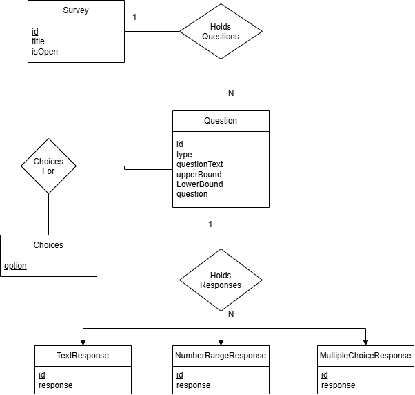

# SYSC4806-Group-Project
## Azure Deployment
Domain link: sysc4806-group-16-project-hmace8gzfwbrhagx.norwayeast-01.azurewebsites.net

This repository contains the Group Project for SYSC 4806, Software Engineering Lab. 
The team will be implementing the Mini-SurveyMonkey concept, with Spring Feature Toggling.

## State of the Project
Implementing the early stages of the project:
Azure deployment (https://github.com/elyssagrant/SYSC4806-Group-Project/issues/2): Complete
Integrate CI (https://github.com/elyssagrant/SYSC4806-Group-Project/issues/3): Complete
Create Survey-creation Frontend (https://github.com/elyssagrant/SYSC4806-Group-Project/issues/7): In progress
Create persistable entities (https://github.com/elyssagrant/SYSC4806-Group-Project/issues/4, https://github.com/elyssagrant/SYSC4806-Group-Project/issues/5, https://github.com/elyssagrant/SYSC4806-Group-Project/issues/8): In progress
Survey creation Controllers (https://github.com/elyssagrant/SYSC4806-Group-Project/issues/14): In Review

## Model Class Diagram

## Persistable Database Schema

## Project Kanban
Link to Kanban board: https://github.com/users/elyssagrant/projects/3

## Local Deployment Instructions
1. Clone Waveform's Git repository onto local machine
2. Open project in IntelliJ
3. Build the project by double-clicking the 'package' option from the Maven toolbar (Found at 'Waveform' > 'Lifecycle' > 'package')
4. Navigate to the project's /target directory
5. Right-click on the 'Waveform-1.0-SNAPSHOT.jar' file and select 'Run'
6. Navigate to http://localhost:8080 from browser to access the locally deployed Waveform webapp
