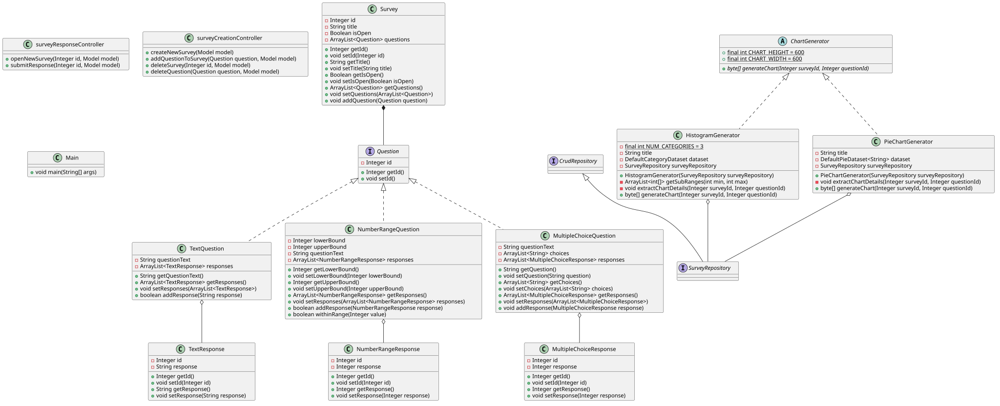

# SYSC4806-Group-Project
This repository contains the Group Project for SYSC 4806, Software Engineering Lab. 
The team will be implementing the Mini-SurveyMonkey concept, with Spring Feature Toggling.

## State of the Project
Implementing the early stages of the project:
Azure deployment (https://github.com/elyssagrant/SYSC4806-Group-Project/issues/2): Complete
Integrate CI (https://github.com/elyssagrant/SYSC4806-Group-Project/issues/3): Complete
Create Survey-creation Frontend (https://github.com/elyssagrant/SYSC4806-Group-Project/issues/7): In progress
Create persistable entities (https://github.com/elyssagrant/SYSC4806-Group-Project/issues/4, https://github.com/elyssagrant/SYSC4806-Group-Project/issues/5, https://github.com/elyssagrant/SYSC4806-Group-Project/issues/8): In progress
Survey creation Controllers (https://github.com/elyssagrant/SYSC4806-Group-Project/issues/14): In Review

## Model Class Diagram

## Persistable Database Schema

## Azure Deployment
Domain link: sysc4806-group-16-project-hmace8gzfwbrhagx.norwayeast-01.azurewebsites.net
